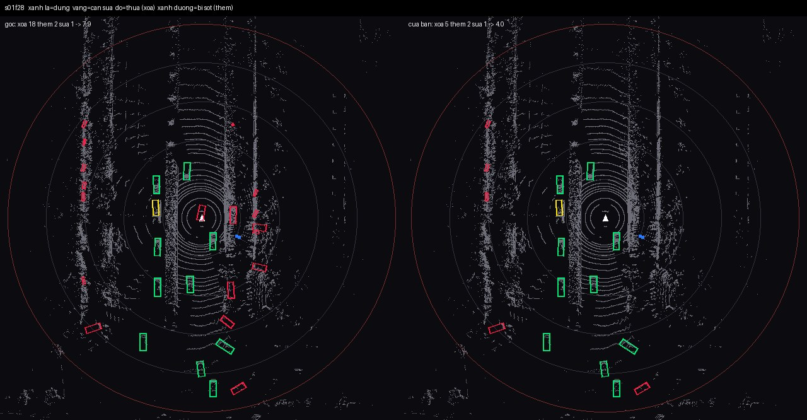

# Báo cáo Day 14 — Nguyễn Thanh Sơn — 2A202603318

> Sao chép file này thành `report/individual/<MSSV>_<HoTen>.md` (không dấu), ví dụ `2A20260000_NguyenVanAn.md`.

- Mã học viên dùng với `--student`: `2A202603318`
- `seed_tag` trong `frames_A.txt`: `d23d5cbcd4`

## 1. Dự đoán trước sweep (bước 5b)

Ghi **trước** khi chạy `scripts/pp_sweep.py`, rồi commit và push ngay (lịch sử commit là bằng chứng thời điểm viết). Không sửa phần này sau khi có kết quả.

- Tham số tôi nghĩ giảm công sửa nhiều nhất: `score_thr` (tăng ngưỡng độ tin cậy lên khoảng `0.3` – `0.4`).
- Vì sao (nhìn ảnh BEV tập A: box thừa nhiều hay box sót nhiều?): Quan sát 3 ảnh BEV và camera chiếu góc của tập A (`s01f28`, `s04f21`, `s05f37`), lỗi chủ yếu là **box thừa (False Positives) quá nhiều** so với box sót. Cụ thể ở hai frame `s01f28` (29 box) và `s05f37` (43 box), mô hình sinh ra hàng loạt cuboid giả (`Car` màu đỏ và `Cyclist` màu xanh lá) đè lên dải phân cách trồng cây bụi, gốc cây và lề đường, trong khi các xe thật chạy trên làn đường hầu hết đều đã được bắt trúng. Vì các bụi cây ven đường có mật độ điểm LiDAR khá dày (nên `min_points` khó lọc hết) nhưng độ tự tin dự đoán của mô hình thường thấp, việc tăng `score_thr` sẽ loại bỏ trực tiếp nhóm box nhiễu này, giúp giảm mạnh thao tác xóa tay khi gán nhãn.

## 2. Tập A: sửa tay và tune

| Cấu hình | Xóa | Thêm | Sửa | Chi phí |
|---|---:|---:|---:|---:|
| Gốc | 57 | 9 | 2 | 27.1 |
| `best_config.json` | 16 | 9 | 2 | 14.8 |

- Tham số đã đổi trong `best_config.json`: `score_thr` tăng từ `0.1` lên `0.5`; `min_points` giữ nguyên ở `0` (các giá trị 5 và 10 cũng cho cùng chi phí 14.8).

- Kết quả leave-one-out:    
  - `s01f28`: chọn `score_thr=0.5`, `min_points=0` → chi phí 4.0 (tốt nhất có thể: 4.0).
  - `s04f21`: chọn `score_thr=0.5`, `min_points=0` → chi phí 7.0 (tốt nhất có thể: 7.0).
  - `s05f37`: chọn `score_thr=0.5`, `min_points=0` → chi phí 3.8 (tốt nhất có thể: 3.8).

- Cấu hình có ổn định trên từng frame không,vì sao tôi vẫn chọn (hoặc không chọn) nó: Cấu hình khá ổn định trên 3 frame A vì kết quả leave-one-out đều đạt mức chi phí tốt nhất có thể trên từng frame. Tổng chi phí giảm từ 27.1 xuống 14.8, tương đương giảm khoảng 45.4%. Số box cần xóa giảm từ 57 xuống 16, trong khi số box cần thêm và sửa không thay đổi. Tôi chọn cấu hình này vì giúp giảm đáng kể công sửa nhãn trên tập A.

## 3. Trước/sau (bước 8)

- `scripts/pp_compare.py` báo giảm khoảng **45.4%** công sửa trên tập A, chi phí giảm từ 27.1 xuống 14.8.
- Dự đoán ở mục 1 đúng hay sai: Dự đoán tăng `score_thr` để giảm box thừa là đúng. Sau khi tune, `score_thr` tăng từ 0.1 lên 0.5, số box cần xóa giảm từ 57 xuống 16; số box cần thêm giữ nguyên ở 9 và số box cần sửa giữ nguyên ở 2. Tổng chi phí sửa giảm 45.4%.

## 4. Tập B

Số đo từ `scripts/pp_prelabel.py --frames d14_<ID>/frames_B.txt --config d14_<ID>/best_config.json --gt d14_<ID>/ref_B.json`:

| Xóa | Thêm | Sửa | Chi phí |
|---:|---:|---:|---:|
| 33 | 6 | 1 | 16.4 |

- Loại box tốn công sửa nhất ở tập B: Chưa xác định được theo từng class từ thống kê tổng hiện tại.

## 5. Giới hạn

- **Số lượng frame tune còn ít:** Tập A chỉ có 3 frame nên chưa đủ đại diện cho toàn bộ các tình huống giao thông. Cấu hình tốt nhất có thể phù hợp với 3 frame này nhưng chưa chắc đạt hiệu quả tương tự trên dữ liệu khác.

- **Giới hạn về class của model:** Model PointPillars sử dụng trọng số KITTI được huấn luyện trên các class nhất định, không bao phủ đầy đủ các loại phương tiện như Truck và Bus trong dữ liệu thực tế. Vì vậy, khả năng nhận diện các class này còn hạn chế.

- **Chi phí sửa chỉ là giá trị ước lượng:** Công thức Delete/Add/Modify sử dụng trọng số quy đổi để ước lượng công sức chỉnh sửa, chưa phản ánh chính xác thời gian thực tế mà annotator cần để sửa từng cuboid trên CVAT.

- **Phụ thuộc vào ngưỡng cấu hình:** Việc tăng `score_thr` từ 0.1 lên 0.5 giúp giảm số box dự đoán thừa trên tập A, nhưng cũng có nguy cơ loại bỏ nhầm những đối tượng có confidence thấp. Cấu hình cần được kiểm tra thêm trên nhiều frame và các tình huống khác nhau.